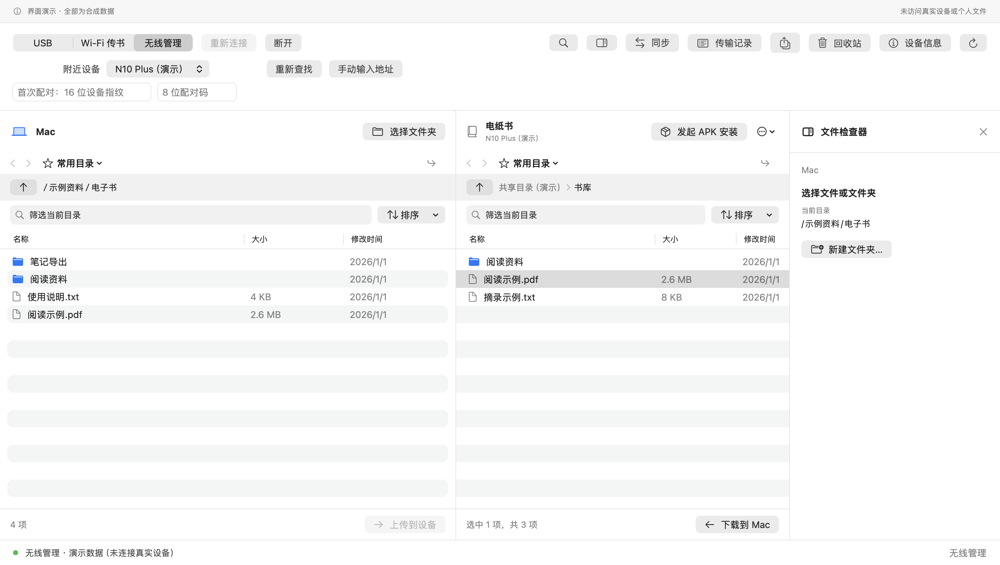
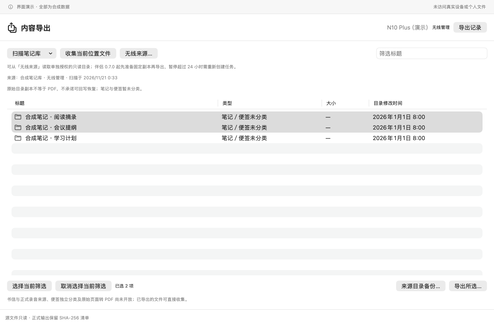

# 汉王电纸书工具箱

运行在 macOS 上的 SwiftUI 双栏文件管理工具。左侧浏览 Mac，右侧浏览电纸书，支持 USB、原厂 Wi-Fi 传书和 Android 伴侣无线管理，可用于传文件、发送 APK、管理目录、比较与同步文件，以及导出原始内容目录。

当前处于开发阶段。文件管理、同步及内容导出基础流程已在 N10 Plus 验证；内容导出中的笔记可阅读格式转换和完整可恢复备份尚未完成。

快速入口：[界面截图](#界面截图) · [构建与安装](#构建与安装) · [连接设备](#连接设备) · [文件管理](#文件管理与预览) · [目录同步](#目录比较与同步) · [内容导出](#内容导出) · [常见问题](#常见问题)

## 界面截图

以下图片使用当前 SwiftUI 视图与合成演示数据生成，展示 Mac 工具箱的实际界面布局。文件名、目录和设备信息均为示例，不包含真实设备内容，也不作为真机验收记录。点击图片可查看原图。

### 双栏文件管理

左侧浏览 Mac，右侧浏览电纸书；顶部切换连接方式，支持目录导航、筛选、排序、传输和文件检查器。



### 传输队列

在传输记录中查看完成、等待和中断项目；暂停的任务保留记录，连接原设备后可继续或重试。


### 内容导出

扫描已授权来源后按标题筛选和选择内容，可导出所选原始目录或备份来源目录；界面同时提示当前支持范围。



截图更新流程见 [截图维护说明](docs/assets/screenshots/README.md)。

## 当前进展

文档更新：2026-11-21。版本以当前源码中的应用元数据为准，不代表已发布安装包。

| 项目 | 当前基线 |
|---|---|
| Mac 工具箱 | 0.3.2，构建 9 |
| Android 伴侣 | 0.7.1，版本代码 13 |
| Mac 环境 | Apple Silicon、macOS 26、Xcode、Homebrew libusb |
| 真机设备 | 汉王 N10 Plus，型号 N10Q464，Android 11，固件 1.00.88，硬件 12.75 |
| USB 识别范围 | 当前匹配自报厂商为 HANVON 的 `2207:0007` 设备 |

已经实现的主要功能：

- **文件管理**：双栏浏览、目录跳转、收藏、排序、筛选、子目录搜索及快速查看；USB 和新版伴侣支持设备目录新建、重命名、复制、移动及回收恢复。
- **无线连接**：同一局域网自动发现，首次配对后记住设备，服务换端口或设备唤醒后自动重连，并恢复同一授权目录中的浏览位置。
- **应用安装**：USB 将 APK 发送至 Download；无线伴侣可发起系统安装请求，由使用者在电纸书上确认。
- **传输队列**：批量上传下载、暂停、继续、调整顺序、单项取消和重试；伴侣普通文件支持字节级断点续传。
- **目录同步**：单向比较与复制、同步预设、SHA-256 核对与基线、双向计划、逐项或批量选择冲突版本，以及更新前备份和旧版本恢复。
- **内容导出**：USB 或专用无线只读来源扫描笔记索引、导出原始目录副本、收集已有文件；伴侣 0.7.1 支持先准备固定副本，再下载和续传。

其他机型、Intel Mac 和不同固件尚未作为本项目的真机基线验收。详细范围见 [测试说明](docs/testing/README.md) 与 [内容导出验收记录](docs/content-export-progress.md)。

## 选择连接方式

| 能力 | USB | 原厂 Wi-Fi 传书 | 无线管理（伴侣 0.7.1） |
|---|---|---|---|
| 浏览、下载 | MTP 公开的共享存储 | 原厂服务公开范围 | 已授权共享目录及其子目录 |
| 上传到指定目录 | 支持 | 上传至原厂收件入口 | 支持 |
| 上传文件夹、管理设备目录 | 支持 | 不支持完整目录管理 | 支持 |
| 设备内复制、移动与回收恢复 | 支持 | 不支持 | 支持 |
| APK | 发送至 Download，设备端手动打开 | 使用其他连接方式 | 提交系统安装请求，设备端确认 |
| 目录比较与同步 | 支持 | 不支持 | 支持 |
| 普通文件字节级续传 | 不支持，从文件开头重试 | 不支持 | 支持 |
| 独立只读内容来源与设备固定副本 | 使用 MTP 稳定读取 | 不支持 | 支持，须单独批准来源 |

首次使用可以先通过 USB 安装伴侣，再切换到无线管理。上述流程不要求开启 USB 调试、ADB 或 Root；可访问范围取决于 MTP 和用户通过 Android 系统选择器授予的目录权限。

## 构建与安装

仓库不保存应用安装包、签名材料或真实设备数据。以下命令在项目根目录执行。

### Mac 工具箱

准备 Xcode 和 Homebrew 的 libusb。当前 USB 构建配置使用 Apple Silicon 的 Homebrew 安装布局。

```sh
brew install libusb
scripts/build-app.sh
open .build/HanvonToolbox.app
```

构建产物为 `.build/HanvonToolbox.app`，其中静态链接 libusb。

需要在本机反复构建并保留已有配对时，可先配置项目专用的本机签名身份：

```sh
scripts/setup-local-signing.sh
scripts/build-app.sh
```

私钥保存在当前用户钥匙串，`.mac-signing/` 保留本机配置及签名组件。已有身份会复用；清理 `.build` 不会删除这些配置。也可以通过 `HANVON_CODESIGN_IDENTITY` 指定已有身份；未配置时使用临时签名。

首次签名或从临时签名版迁移时，macOS 可能询问 `codesign` 使用专用私钥，或询问 `HanvonPairingKeychain` 读取工具箱配对。核对请求者与条目后，可选择“始终允许”；密码只在系统弹窗中输入。更换签名身份或修改钥匙串组件后，可能需要重新授权。

本机自签名构建用于本机验证。对外分发仍需准备 Developer ID 签名、公证及第三方许可材料。

### Android 伴侣

准备 JDK 17、Android SDK platform 34 和 Build Tools 34.0.0，然后运行：

```sh
scripts/build-android.sh
```

当前版本产物为 `.build/android/Hanvon-Companion-0.7.1.apk`。

构建需要本地 `.android-signing/companion.p12`。口令通过 `HANVON_ANDROID_KEYSTORE_PASSWORD`、`HANVON_ANDROID_PASSWORD_FILE` 指定的文件，或默认的 `.android-signing/password` 提供。新环境需先准备自己的开发签名材料；脚本不会自动生成替代密钥。覆盖升级必须沿用原应用的签名身份。具体规则见 [隐私与密钥管理](SECURITY.md)。

将 APK 通过 USB 发送到电纸书 Download，在设备文件管理器中打开并确认安装。覆盖升级时保留原授权目录与配对；只有需要修改访问范围时再重新选择目录。

## 连接设备

### USB 连接

1. 用支持数据传输的 USB 线连接 Mac 和电纸书，在电纸书上选择“文件传输”。
2. 打开工具箱，左上角选择 **USB**，点击 **连接**。
3. 左栏点 **选择文件夹** 设置 Mac 收发目录；右栏进入设备目标目录，即可开始文件传输。
4. 点 **设备信息** 查看设备公开的 MTP 厂商、产品、版本、序列号和存储信息。USB 页面不保证提供 Android 系统构建号。

USB 只管理 MTP 公开的共享存储，不能直接读取任意 Android 应用私有目录。当前单文件上限略低于 4 GiB；USB 中断重试会从当前文件开头重新传输。

### 无线管理：首次配对

1. 在电纸书打开 **汉王工具箱伴侣**，点 **选择共享目录**。可在系统选择器中新建并选择“汉王工具箱”等共享子目录。
2. Mac 和电纸书接入同一局域网，在伴侣点 **开启无线管理**。
3. Mac 工具箱选择 **无线管理**，在 **附近设备** 中选中电纸书。
4. 首次配对时输入设备屏幕显示的指纹和临时配对码。首次使用局域网时，按 macOS 提示允许工具箱访问本地网络。
5. 配对成功后，右栏显示所选共享目录。进入哪个子目录，就向哪个目录上传。

Android 11 系统选择器会限制内部存储根目录和整个 Download 的授权。无线管理访问的是所选目录及其子目录，不是任意设备路径。

### 后续连接、后台与休眠

配对令牌保存在 Mac 登录钥匙串。后续打开工具箱、重启伴侣服务或设备端口变化时，会尝试用原配对自动重连，无需反复输入配对码。伴侣每次开启服务会更新临时配对码；正常重启服务不会改变原设备身份。

- 返回电纸书主屏幕后，伴侣通过前台服务继续运行；通知栏可停止无线管理。
- 本项目 N10 Plus 实测：未接 USB、熄屏休眠时连接可能超时；唤醒回到主屏幕后，Mac 可自动重连，无需手动打开伴侣。
- 连回同一设备、同一共享目录后，会恢复原浏览子目录；子目录不存在时回到最近可用的上一级。共享目录更换后从新根目录开始。
- 在 Mac 主动点 **断开** 后，需要再次点 **连接**，不会立即自动重连。
- 停用配对可在 Mac 点 **忘记此设备**，或在伴侣点 **清除已配对的 Mac**。

自动发现不可用时，点 **手动输入地址**。连接已记住的设备时，保留 **使用已保存的配对**，填写设备当前显示的完整 HTTPS 地址；地址变化仍须通过原设备身份验证。连接另一台设备时，再关闭该选项并输入对应配对信息。

### 原厂 Wi-Fi 传书

在电纸书开启原厂 **Wi-Fi 传书**，Mac 工具箱选择 **Wi-Fi 传书**，输入设备显示的完整地址并连接。

右栏可浏览、下载原厂服务公开的文件。上传使用 **选择文件发送** 或拖入文件，目标为原厂传书收件入口；当前浏览目录不会改变上传位置。需要指定上传目录、管理目录、同步或发起 APK 安装时，请改用 USB 或无线伴侣。

## 文件管理与预览

1. **浏览**：双击文件夹进入；用面包屑、上一级、前进或后退返回。双击 Mac 普通文件会用默认应用打开，双击设备普通文件会下载到左侧目录。
2. **上传与下载**：左栏选中文件或文件夹，点 **上传到设备**；右栏选中项目，点 **下载到 Mac**。也可把 Mac 文件拖入右栏发送。
3. **目录操作**：在 **设备操作** 或右键菜单中新建文件夹、重命名。设备内复制或移动时，先选择源项目，再进入目标目录，选 **粘贴到此处**。
4. **查找**：筛选框只过滤当前目录；**搜索子目录** 按文件名递归搜索，可定位结果。单次最多扫描 20,000 项、返回 1,000 项，超出时缩小范围。
5. **检查与预览**：选中项目后，在右侧文件检查器查看信息。设备文件的 **快速查看** 会先下载到私有临时目录，再交给 macOS 预览，不会写入左栏目录；能否预览取决于文件格式支持。
6. **收藏与排序**：两栏支持常用目录、输入路径跳转，以及名称、大小、修改时间排序。设备收藏绑定原设备、存储和连接方式；缺失的信息显示为“—”。

普通上传、下载不会直接覆盖同名文件：同名文件跳过，同名目录逐级复用。需要更新已有文件时，使用下面的同步预览与冲突处理。搜索与普通同步会跳过隐藏项目、Mac 符号链接及文件包。

### APK 发送与安装

- **USB**：点 **发送 APK**，选择安装包。工具箱将其放入设备 Download；随后在电纸书文件管理器中打开安装。
- **无线管理**：点 **发起 APK 安装**。伴侣接收至私有待安装区，并交给 Android 系统安装器。首次可能需要在设备端允许来自伴侣的安装，再确认或取消。

Mac 显示“已发起安装请求”表示设备收到请求，不表示系统安装已经完成。退出或重试前，请先查看电纸书上的安装结果。

## 传输队列、暂停与恢复

从工具栏打开 **传输记录**，可查看每项完成、跳过、失败、中断或等待状态，以及传输速度和预计剩余时间。

- 多选文件或文件夹开始传输，也可从右键菜单先加入暂停队列，再排序并继续。
- 正在执行的队列可 **暂停队列／继续队列**。项目菜单支持单项重试、取消、提前或延后；取消项不会被“重试未完成”再次执行。
- 失败或中断后，连接原设备、原存储和原授权目录，再点 **重试未完成**。已完成和已跳过的项目不会重复传输。
- 普通队列因连接中断而保留自动继续标记时，重连原设备后会自动继续；主动暂停、尚未开始和普通失败的任务需要手动继续或重试。
- 伴侣普通文件上传、下载支持不超过 4 GiB 单文件的字节级续传，分块最多 1 MiB，提交或发布前核对整文件 SHA-256。源文件改变时停止，不能沿用旧偏移。
- USB、原厂 Wi-Fi 和旧伴侣不具备相同的字节级续传能力。可读取序列号的 USB 设备支持跨启动重试；原厂 Wi-Fi 传书仅支持同一次工具箱运行期间重试。

取消会清理本机对应缓存，并在设备可达时清理该任务的设备缓存。设备端普通续传记录按闲置期限回收；离线时无法立即清理设备缓存。APK、备份更新和旧版本恢复使用各自的重试规则。

**内容导出有独立记录和恢复流程**，不会随普通传输队列自动恢复，见下文。

## 目录比较与同步

### 单向复制

1. 使用 USB 或无线管理连接设备，在双栏分别打开要比较的目录。
2. 点 **同步**，选择方向，再点 **比较目录**。
3. 检查待复制文件、空目录、同名冲突和已存在项目。需要区分同大小文件时，点 **核对同名内容** 计算 SHA-256；大小相同不等于内容相同。
4. 核对后点 **开始同步**，复制任务进入传输记录。

普通单向同步主要复制目标缺少的项目。同名目录合并，冲突或已记录的基线变化项目保留待处理，不自动覆盖，也不把源端删除传播到目标。

### 预设、基线与双向计划

1. 通过 **同步预设 → 保存当前目录为预设…** 保存两端目录和方向。预设绑定设备、存储及连接方式。
2. 下次打开预设，点 **核对内容与基线**，记录确认一致的文件状态。再次核对时可区分仅 Mac 修改、仅设备修改、两端修改及单侧缺失。
3. 点 **双向计划**，检查新增、更新、已一致和需处理项目。删除预设也会删除对应基线；目录改名或移动后应重新选择并保存。
4. 对已成功核对两端内容的普通文件冲突，逐项选择 **使用 Mac 版本**、**使用电纸书版本** 或 **暂不处理**。
5. 可按筛选批量选择、取消选择或批量处理冲突。底部汇总所有已选项目及方向；**筛选外已选项目也会执行**。
6. 点 **备份并同步所选**。更新前再次校验两端内容并备份被更新版本；预览后内容变化则停止，需重新比较。

双向计划是经预览和选择后执行的文件同步，不是后台自动镜像。类型冲突、重名、缺失或不能校验的项目继续保留原状。

### 旧版本与设备恢复副本

从 **传输记录 → 旧版本** 可恢复更新前版本。恢复前会再次备份当前文件，记录绑定原设备、存储和 Mac 目录。

- **更多** 菜单可导出旧版本，或将已完成的 Mac 备份移到访达废纸篓。未完成任务仍依赖的副本不能清理。
- 需要放回 Mac 备份时，在访达废纸篓中选中该备份文件夹，使用 **放回原处**，再重开旧版本列表。
- **设备恢复副本** 管理更新时保留在设备上的隐藏旧副本。点 **清理设备副本…** 会永久删除对应旧副本；清理前核对当前文件、大小、SHA-256 及未完成任务依赖。需要保留旧内容时先导出 Mac 备份。

## 文件回收站

在 Mac 或 USB／无线管理的文件菜单中选 **移入回收站**，然后从工具栏 **回收站** 恢复到原目录。

- Mac 文件进入工具箱自己的本机回收目录，独立于访达废纸篓。
- 设备回收文件放在对应存储的隐藏目录 `.HanvonToolbox-Trash`，原位置记录保存在这台 Mac，跨启动保留。
- 恢复设备文件需要原设备、原存储和原连接方式。同名时恢复成带“恢复副本”名称的副本；原目录不存在时保留回收副本并提示。
- 回收文件仍占用所在端空间。**永久删除…** 需要再次确认，之后不能从工具箱回收站恢复。

回收站与“同步更新前的旧版本备份”是两个独立入口，不要用删除回收记录代替管理同步备份。

## 内容导出

目前可导出的是**受支持笔记索引对应的原始目录副本**，或收集已经存在的 PDF、图片、音频、文本等文件。原始目录副本不等于能直接阅读的 PDF，也不承诺能恢复到电纸书。

开始前请保存笔记、退出编辑并结束录音。未知保护状态或受保护记录会被拒绝导出；索引变化或活动数据库事务也会阻止继续。

### USB 扫描与文件收集

1. 连接 USB，点工具栏 **内容导出**。
2. 在 **扫描笔记库** 中选择 **扫描设备默认笔记库**，读取设备 `notes` 中受支持的索引。
3. 如果笔记库位于其他已公开目录，先在主窗口打开该目录，再选 **扫描当前位置笔记库**。当前目录须包含受支持的 `.database/HvNote.db`。
4. 收集已有文件时，在主窗口打开文件所在目录，再选 **收集当前位置文件**。
5. 按标题筛选并勾选项目，点 **导出所选…**，选择 Mac 目标目录。

### 无线独立只读来源

普通文件管理的共享目录与内容导出的只读来源分别授权，无需为了导出而更换原共享目录。

1. 在伴侣点 **添加笔记来源（只读）** 或 **添加文件收集来源（只读）**，通过系统选择器选择目标目录。
2. 开启无线管理，Mac 用已有配对连接后，打开 **内容导出 → 无线来源…**。
3. 选中来源，点 **申请只读访问**。已有无线配对不会自动获得新增来源的读取权。
4. 在电纸书核对与 Mac 相同的六位请求编号和来源名称，点 **核对并允许请求**，再确认只读访问。
5. Mac 显示已允许后，点 **扫描笔记** 或 **浏览来源**，选中项目并导出。

来源只读，不会转发文件上传、重命名、删除或 APK 安装操作。最多可登记八个来源，实际可选范围仍受 Android 系统目录权限限制。

要停止访问，在伴侣点 **撤销此来源的 Mac 访问**，或点 **移除此内容来源**，并确认弹窗。移除后应确认来源已从伴侣列表消失，再在 Mac **刷新来源**。操作保留设备原文件和原文件管理共享目录；已经完成的 Mac 输出也不会被自动删除。

离线时，来源窗口会标记上次读取结果并禁用操作，不能把缓存列表当作当前授权状态。

### 固定副本、暂停与输出

伴侣 0.7.1 的专用内容来源会先在设备私有目录准备固定副本，校验就绪后再供 Mac 下载。准备后即使实时源文件变化，续传仍使用原固定副本；准备期间检测到变化时会停止。原共享目录和 USB 仍使用原来的稳定读取流程。

- 点 **暂停导出** 后，已就绪副本和未完成下载可保留；重开 Mac、连回原设备后，从 **导出记录 → 继续／重试** 手动继续。
- 内容导出不会自动恢复，也不会跨 USB 和 Wi-Fi 切换来源。准备阶段因设备服务停止而失效时，需要重新创建任务。
- 固定副本默认闲置租期为 24 小时，活动访问会续租。过期后不能直接沿用旧快照偏移，需要重新创建任务。
- 每份固定副本上限 1 GiB，总资源上限 2 GiB，并保留至少 256 MiB 设备可用空间；超限时分批处理或改用 USB。资源清单最多 20,000 项、深度 64 层。
- 正常完成或 **取消未完成** 后尝试释放设备副本。来源被撤销或移除后，旧任务被拒绝，未发布缓存会在检测到失效时清理，已完成输出保留。

每项输出是普通 `.hanvonexport` 文件夹，包含 `item.json` 清单及 `raw` 原始资源；批次目录包含 `result.json`。文件保留 SHA-256 校验结果和空目录。单项笔记输出不附整份索引数据库。

**来源目录备份…** 会包含整个所选来源目录，包括隐藏资源、索引和未单独勾选的内容；确认范围后再执行。它仍是来源目录备份，不是已经验证可恢复的完整笔记库备份。

固定副本保证就绪后的资源不再变化。准备时多次读取未观察到变化，并不代表原应用数据库与附件具有同一时刻的事务一致性。

### 尚未完成与验收边界

- 笔记和便签尚未可靠区分；书信及正式录音缺少完整适配。已有音频文件可收集，不等于完成正式录音索引与关联信息导出。
- 原始页面转 PDF／图片、完整笔记库恢复、内容任务自动恢复及跨批次增量跳过尚未开放。
- 本轮固定副本验收使用隔离合成来源：覆盖 64 MiB 导出、暂停重开、服务重启、源文件替换后的隔离、取消释放、来源移除拒绝及缓存清理。
- 真实笔记的页序、底纹、附件等资源闭包，以及自然等待 24 小时过期、低空间和多设备场景仍需扩大真机验证。

详见 [功能设计](docs/content-export-design.md)、[技术方案](docs/content-export-technical.md) 和 [开发进展与验收记录](docs/content-export-progress.md)。

## 常见问题

| 问题 | 处理方式 |
|---|---|
| USB 未识别或 MTP 打不开 | 检查数据线和“文件传输”模式，退出占用设备的其他 MTP 工具后重连。N10 Plus 实测拔线后可能需要重启电纸书再选择文件传输。 |
| 找不到无线设备 | 唤醒电纸书并确认无线管理开启、两端处于同一局域网；检查 macOS **隐私与安全性 → 本地网络**。自动发现受限时使用设备屏幕上的当前 HTTPS 地址。 |
| 每次重编都出现钥匙串询问 | 检查是否复用同一本机签名身份及钥匙串组件；核对系统弹窗后配置授权，见构建说明。 |
| 原厂 Wi-Fi 上传后在当前目录找不到文件 | 原厂上传走收件入口；需指定目录时使用 USB 或无线管理。 |
| 按钮禁用或来源列表未更新 | 确认设备在线且当前没有其他操作占用；离线列表只是上次读取结果，恢复连接后刷新。 |
| 内容来源已添加但不能读取 | 还需在 Mac 申请并在电纸书单独批准；核对来源、请求编号及系统目录权限是否仍有效。 |
| 移除来源后 Mac 仍显示旧状态 | 确认设备端移除弹窗已确认、列表中来源已消失，再在在线状态下刷新。 |
| 文件没有覆盖或同步没有执行某项 | 普通传输跳过同名文件；检查同步预览、冲突选择和已选范围。更新已有文件使用经核对的双向计划。 |
| 导出完成却不能打开笔记 | 当前笔记输出为原始目录副本，页面格式转换尚未实现；需要可读文件时先使用电纸书自身导出，再通过工具箱收集。 |

## 开发、测试与仓库规则

Mac、Android、协议和测试放在同一仓库。首次 clone 后按 [贡献说明](CONTRIBUTING.md) 启用 Git 钩子；提交前遵守 [项目规则](AGENTS.md) 和 [隐私与密钥管理](SECURITY.md)。签名材料、真实设备数据、配对信息与生成安装包不进入 Git，问题报告也不应附带这些内容。

无设备自动检查：

```sh
python3 -m unittest discover -s scripts/tests -v
scripts/test-java.sh
scripts/test-swift.sh
```

当前基线记录为 72 项 Swift 测试、14 项仓库隐私测试，另有四个纯 Java 测试入口。GitHub 自动检查包括隐私扫描、隐私回归、Java 测试和合成样例生成；不包含 Mac 签名构建和真机操作。

构建会产出 `toolbox-check`，用于独立发现、USB、原厂传书和伴侣真机诊断。例如只读检查服务发现：

```sh
.build/debug/toolbox-check --discover
```

其他真机回归会创建合成测试文件或目录，须先阅读源码和 [测试说明](docs/testing/README.md)，选择隔离范围；USB 回归前先断开工具箱中的 USB 会话。不要把真实配对码、指纹、内容或原始日志写入提交、命令示例及 CI 输出。

更多文档：[仓库架构与版本](docs/architecture/repository.md) · [无线协议入口](docs/protocol/README.md) · [合成样例生成器](fixtures/README.md)。
